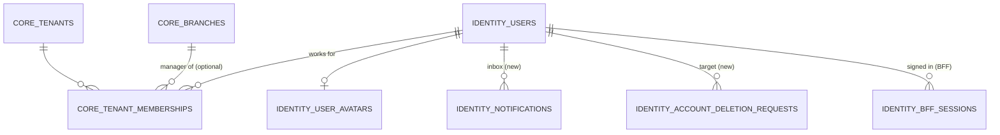
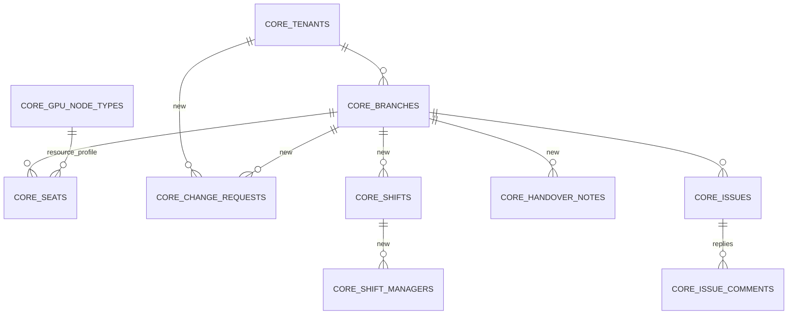

# InstaGPU database design

Status: **accepted** 2026-10-28 (decisions D1–D4 in section 6; migrations 000020–000025 written and applied locally). Sources: `db/migrations` 000001–000019 (ported unchanged from InstaGPU-GC-Core;
column-level detail in the reference's `docs/guide/14-database-schema.md`), the frontend `cloud-game-ops` (types, mock stores,
`approvalService`, `billingService`, `roadmap.md`) and the business rules in `CLAUDE.md`.

What this document decides: which service owns which table, which existing tables we use / leave reserved, and which **new**
tables and columns the frontend needs (migrations 000020+). Nothing here is migrated yet.

## 1. Shape

- **One PostgreSQL 18 database `instagpu`, one schema group per service.** A service writes only its own schemas, through its own login
  (`db/roles`). Other services' data is read through their `/internal` HTTP APIs, never with SQL.
- **Multi-tenant by `tenant_id`** (a tenant = one cafe owner's company). Every cafe-owned table carries `tenant_id` (copied down to
  child tables too, so RLS never needs a join) and has row-level security: `withTx()` sets `app.tenant_id`, or `app.platform_scope = on`
  for `super_admin` / `admin` after the role check. Out-of-scope rows are invisible; the API answers 404.
- **Foreign keys across services:** the existing migrations already have some (e.g. `gaming.sessions.seat_id → core.seats`); they stay,
  since one database serves the pilot. **New** cross-service references are plain `uuid` columns with no FK, so a schema can later move
  to its own database. Within one service's schemas, use real FKs.

| Service | Schemas it writes | Login |
|---|---|---|
| bff-service | `identity.bff_sessions` | `app_bff_login` |
| auth-service | `identity.*`, `core.tenant_memberships` | `app_auth_login` |
| cafe-management-service | `core.*` (except memberships) | `app_cafe_login` |
| session-service | `gaming.*` | `app_session_login` |
| billing-service | `commercial.*`, `billing.*`, `payments.*`, `ledger.*` | `app_billing_login` |
| integration-service | `integration.*` (Horizon, GPU nodes) | `app_integration_login` |
| all but the BFF | append to `audit.events`; own rows in `integration.idempotency_keys` | |

## 2. Conventions (all tables)

| Topic | Rule |
|---|---|
| Ids | `uuid DEFAULT gen_random_uuid()`. Human numbers (statement no., issue no.) are separate columns. |
| Money | Integer **sen**, `bigint`, column suffix `_minor` (`900` = RM 9.00). Never `numeric` or float. |
| Time | `timestamptz` (UTC). Business day = `date` in Asia/Kuala_Lumpur, computed by `libs/domain`, never by the DB clock. |
| Status | `text` + `CHECK (status IN (...))`, upper case (`ACTIVE`, `PENDING`). The API maps to the frontend's lower case. |
| Concurrency | `version integer` on rows edited by people (optimistic lock: `WHERE version = $n`). |
| Who | `created_by` / `updated_by` = `identity.users.id` (plain uuid outside auth-service). |
| Deletes | No hard deletes of business rows. Cafes and branches use `status = 'CLOSED'`, users `DISABLED`. Append-only tables (`audit.events`, `ledger.journal_lines`) refuse UPDATE/DELETE by trigger. |
| Changes | Every change writes an `audit.events` row and takes an `Idempotency-Key`, in the same transaction. |
| Text limits | `CHECK (char_length(x) <= n)` on free text (names 2–120, addresses ≤ 300, notes ≤ 4000). |

## 3. Per service

### 3.1 auth-service: `identity` + memberships

| Table | State | Notes |
|---|---|---|
| `identity.users` | existing | One row per Keycloak `sub` (upserted at first login). `display_name`, `email`, `phone`, `address`, `status` ACTIVE/DISABLED/PENDING. Role is **not** stored here: it is the Keycloak realm role. **Add** `created_by uuid` (frontend shows who created whom). |
| `identity.user_avatars` | existing | Picture ≤ 256 KB in the DB (pilot scale). |
| `core.tenant_memberships` | existing | `(tenant_id, user_id, role, branch_id, status)`. `cafe_owner` → `CAFE_OWNER`, `branch_id` NULL. `manager` (Floor Manager) → `BRANCH_MANAGER`, **one row per branch** (replaces the frontend's `branch_managers` / `managerId`). `super_admin` / `admin` have no memberships. **Add** a unique index on `(user_id, tenant_id, coalesce(branch_id, …))` where ACTIVE. |
| `identity.bff_sessions` | existing (BFF writes) | Encrypted tokens, `sid_hash`, CSRF hash, idle and absolute expiry. |
| `identity.notifications` | **new** | In-app inbox (frontend `notifications` page): `id, user_id, tenant_id NULL, type, title, body, link, read_at, created_at`. Other services create rows through `POST /internal/notifications`. Index `(user_id, read_at NULLS FIRST, created_at DESC)`. |
| `identity.account_deletion_requests` | **new** | Frontend "Deletion requests": `id, target_user_id, requested_by, reason, status PENDING/APPROVED/REJECTED, resolved_by, resolved_at, resolution_note`. Approving **disables** the user (Keycloak + `status`) and blanks phone, address and avatar; it never deletes the row. One PENDING request per user (partial unique index). |

Not in the DB: passwords, 2FA (Keycloak), role (Keycloak), "assignedScope" (derived from memberships).

### 3.2 cafe-management-service: `core`

| Table | State | Notes |
|---|---|---|
| `core.tenants` | existing | The owner's company (frontend "cafe"): code, name, legal name, registration / tax no., TIN, phone, billing e-mail, address, status PENDING/ACTIVE/SUSPENDED/CLOSED. **Add** `onboarded_by uuid` (the Sales Manager who created it; drives the Sales Manager's "my cafes" filter; access stays every cafe, ADR-014) and a logo in the new `core.tenant_logos` (image in the DB, like `identity.user_avatars`). |
| `core.branches` | existing | Location: code, name, address, status (`PENDING` = created by sales, waiting for approval, no sessions; `ACTIVE`, `INACTIVE`, `SUSPENDED`, `MAINTENANCE`, `CLOSED`), `daily_spend_limit_minor`. **Add** `version`, `created_by`. Seat count is **derived** (`count(seats) WHERE status <> 'DISABLED'`), not stored. |
| `core.change_requests` | **new** | Approval queue for the Super Admin (frontend Approvals page, CLAUDE.md rules). Columns: `id, tenant_id, branch_id NULL, kind` (`NEW_TENANT`, `NEW_BRANCH`, `EDIT_TENANT`, `EDIT_BRANCH`), `status` (`PENDING`, `APPROVED`, `REJECTED`, `WITHDRAWN`), `proposed jsonb`, `snapshot jsonb` (live values when submitted, for the diff view), `requested_by, requested_at, decided_by, decided_at, feedback` (`CHECK (status <> 'REJECTED' OR char_length(feedback) >= 5)`), `version`. **One open request per target** (partial unique index on `(coalesce(branch_id, tenant_id)) WHERE status = 'PENDING'`). Rules: a new branch is created `PENDING` with a `NEW_BRANCH` request; a Sales Manager's edit creates `EDIT_*` and **leaves the live row unchanged** until approved; an owner's edit applies at once (no request); resubmitting after a rejection creates a new request (history kept). |
| `core.seats` | existing | Seat code, display order, status, `horizon_username`, `resource_profile → core.gpu_node_types`. Frontend `label` = `code`, `gpuModel` = node type name, "occupied" comes from session-service. |
| `core.gpu_node_types` | existing | Master list of seat types (8 GB, 16 GB … with GPU model). |
| `core.issues`, `core.issue_comments` | existing, **widen** | Frontend Issue Reports. Migration: categories add `GPU`, `PC`, `NETWORK`, `PERIPHERAL`, `SOFTWARE`, `OTHER`; severity adds `CRITICAL`. Replies = `issue_comments` (kind COMMENT). |
| `core.shifts` | **new** | Frontend Shift Management: `id, tenant_id, branch_id, name, start_time time, end_time time` (end < start = overnight), `weekdays smallint` (bit mask Mon=1 … Sun=64), `break_start, break_end, active, created_by, version`. |
| `core.shift_managers` | **new** | `(shift_id, user_id, tenant_id)`, PK `(shift_id, user_id)`. The user must hold a `BRANCH_MANAGER` membership for that branch (checked through auth-service when assigning). |
| `core.handover_notes` | **new** | Frontend shift handover: `id, tenant_id, branch_id, shift_id NULL, summary, pending_tasks, incidents, cash_notes, priority INFO/ATTENTION/URGENT, author_id, created_at, acknowledged_by, acknowledged_at`. Notes are not edited; a wrong note is superseded by a new one. |
| `core.platform_settings`, `core.spend_limit_alerts` | existing | Unchanged. |
| `core.machines`, `core.seat_machine_assignments` | existing / reserved | Horizon desktops; assignments reserved. |

Seat activity log (frontend "seat history"): **no table**. It is `audit.events` filtered by `resource_type = 'seat'` (before/after in `metadata`).

### 3.3 session-service: `gaming`

| Table | State | Notes |
|---|---|---|
| `gaming.sessions` | existing | One gamer on one seat: status, `billable_started_at`, `ended_at`, reason, who started / ended, Horizon tracking. One open session per seat (partial unique index). Feeds the floor, the dashboard and the nightly usage for billing. |
| `gaming.horizon_observations` | existing | Raw Horizon events for billable intervals (append-only). |
| `gaming.agent_status`, `game_activity`, `thin_clients`, `thin_client_events` | existing | Seat / thin-client agent state and history (retention 30 days). |
| `gaming.bookings` | existing | Pre-booking; hidden in the frontend for now. |
| `gaming.games`, `game_versions`, `game_runs`, `gamers`, `horizon_sessions`, `provisioning_jobs` | reserved | No game catalog in V1; no gamer records (D1). |

### 3.4 billing-service: `commercial`, `billing`, `payments`, `ledger`

| Table | State | Notes |
|---|---|---|
| `commercial.commercial_accounts` | existing | **One per tenant (owner)**: postpaid, daily cycle, standard / discount rate per hour (sen), payment-hold state and override. |
| `commercial.usage_records` | existing | Billable connected time per session and business day, written once by the nightly run. |
| `commercial.payment_hold_events` | existing | History of holds: applied, overridden, lifted. |
| `commercial.pricing_plans`, `rate_cards`, `rate_rules`, `usage_meters` | existing | Rates, with per-tenant terms. |
| `billing.billing_runs` | existing | One per business date, repeatable. |
| `billing.invoices` + `invoice_lines` | existing, **add a column** | Daily statement per owner. **Add `branch_id` to `invoice_lines`** so one owner statement shows per-branch lines (the frontend Branch Billing page lists charges per branch). |
| `billing.receivables`, `credit_notes`, `reminders` | existing | Outstanding amount, corrections, reminders. |
| `payments.payment_orders`, `payment_transactions`, `webhook_events`, `provider_outages` | existing | HitPay DuitNow QR: the order holds the QR reference and expiry; the webhook is stored once and applied once; the payment and its journal entry commit in one transaction. |
| `ledger.accounts`, `journal_entries`, `journal_lines` | existing | Double entry, balanced at commit, append-only. |
| `billing.charges`, `commercial.wallets`, `wallet_holds`, `products`, `entitlement_*`, `payments.refunds`, `settlements`, `settlement_lines` | reserved | Not used. Frontend "settlements" are **not** `payments.settlements` (those are PSP payouts). |

### 3.5 integration-service: `integration`

| Table | State | Notes |
|---|---|---|
| `horizon_snapshot`, `horizon_unmatched`, `horizon_login_check`, `sync_status` | existing | Horizon state for the floor and alerts. |
| `integration.gpu_nodes` | **new** | Frontend GPU Nodes page (Super Admin): the physical GPU hosts. `id, name, branch_id NULL, location, gpu_model, serial_number, ip_address, driver_version, cuda_version, vbios_version, installed_at, last_maintenance_at, status` (ONLINE/OFFLINE/WARNING/MAINTENANCE/OVERLOADED), `health` (HEALTHY/DEGRADED/CRITICAL), latest metrics (`temperature_c, utilization_pct, memory_used_mb, memory_total_mb, power_w, fan_pct, clock_mhz, memory_clock_mhz`), `metrics_at`. Not tenant-scoped (platform only, no RLS). Latest values only, no history (D4). |
| `idempotency_keys` | existing, shared | Rows separated by `scope` (one per service + route). |
| `domain_events`, `outbox_events`, `inbox_events` | existing | Outbox pattern. Unused while there is no broker; services call each other over HTTP. |
| `assets`, `device_*`, `external_refs`, `session_tickets` | reserved | |

### 3.6 Shared: `audit.events`

Append-only: `tenant_id, actor_type, actor_id, action, resource_type, resource_id, outcome` (SUCCESS/DENIED/ERROR), `metadata` (before / after,
reason, correlation id), `occurred_at`. RLS by tenant. Every service inserts its own rows; nobody updates or deletes.

## 4. Frontend → database map

| Frontend model | Stored in |
|---|---|
| `User` (name, email, phone, address, avatar, createdBy) | `identity.users`, `identity.user_avatars` |
| `User.role` | Keycloak realm role (`super_admin`, `admin`, `cafe_owner`, `manager`) |
| `User.assignedScope` | derived: `core.tenant_memberships` (staff roles: every cafe) |
| `User.is2FAEnabled` / `twoFAMethod` | Keycloak |
| Cafe (`cafeId`) | `core.tenants` |
| `Branch` (status, address, owner, manager, admin) | `core.branches` + memberships + `core.tenants.onboarded_by` |
| `Branch.pendingEdit`, `approvalFeedback`, `editFeedback`, `ApprovalRequest` | `core.change_requests` |
| `Branch.billing.costPerMinute` | `commercial.commercial_accounts` rates (per owner, per hour, D2); per-minute is display only |
| `Seat` | `core.seats` (+ live status from `gaming.sessions`) |
| `SeatActivityEntry` | `audit.events` (resource_type `seat`) |
| `Shift`, `HandoverNote` | `core.shifts`, `core.shift_managers`, `core.handover_notes` |
| `IssueReport`, `IssueReply` | `core.issues`, `core.issue_comments` |
| `Charge`, `Payment`, `DuitNowQr` | `billing.invoices` / `invoice_lines`, `payments.payment_orders` / `payment_transactions` |
| `Settlement`, `CustomerWallet` | **not stored** (D1: owner billing only); the frontend Settlements page is removed or stays a mock |
| `Booking` | `gaming.bookings` (hidden) |
| `GPUNode` | `integration.gpu_nodes` |
| `DeletionRequest` | `identity.account_deletion_requests` |
| notifications | `identity.notifications` |

## 5. New migrations (written)

| # | Owner | Change |
|---|---|---|
| 000020 | auth | `identity.users.created_by`; `identity.notifications`; `identity.account_deletion_requests`; membership uniqueness index |
| 000021 | cafe | `core.tenants.onboarded_by`, `core.tenant_logos`; `core.branches.version`, `created_by`; `core.change_requests` + RLS |
| 000022 | cafe | `core.shifts`, `core.shift_managers`, `core.handover_notes` + RLS |
| 000023 | cafe | widen `core.issues` category and severity checks |
| 000024 | billing | `billing.invoice_lines.branch_id` |
| 000025 | integration | `integration.gpu_nodes` |

Each new tenant table gets the same RLS as the reference (`p_tenant_api` / `p_platform_api`, written once for `app_api` and mirrored to the
owning service by `db/roles`), and grants for the owning service role in `db/roles/01-service-roles.sql`.

## 6. Decisions

Decided:

- **D1 (2026-10-28): owner billing only.** InstaGPU bills the cafe owner for connected time (reference model). The platform does not
  record what a cafe charges its gamers: no customer records, wallets, deposits, refunds or per-session settlements. Sessions keep no
  price fields; the frontend Settlements and customer-wallet screens have no backend.

- **D2 (2026-10-28): rate per owner, per hour.** Rates live on `commercial.commercial_accounts` (standard and discount rate, sen per
  hour), as in the reference. The frontend's "RM per minute per branch" is display only: the API may show the hourly rate divided by 60,
  but billing never stores or charges per-minute or per-branch rates. Statement lines still carry `branch_id` (000024), so each
  branch's hours are shown.
- **D3 (2026-10-28): a "cafe" is the owner's company.** Frontend `cafeId` = `core.tenants.id` (one owner, one or more branches); a
  branch is one location (`core.branches`). Billing, payment hold and the owner's money view are per tenant.
- **D4 (2026-10-28): GPU nodes keep the latest metrics only.** `integration.gpu_nodes` holds one row per host with its last values and
  `metrics_at`; no history table. Choosing the metrics source (vSphere, NVIDIA DCGM, an agent) and adding history are later work.

No open decisions.
